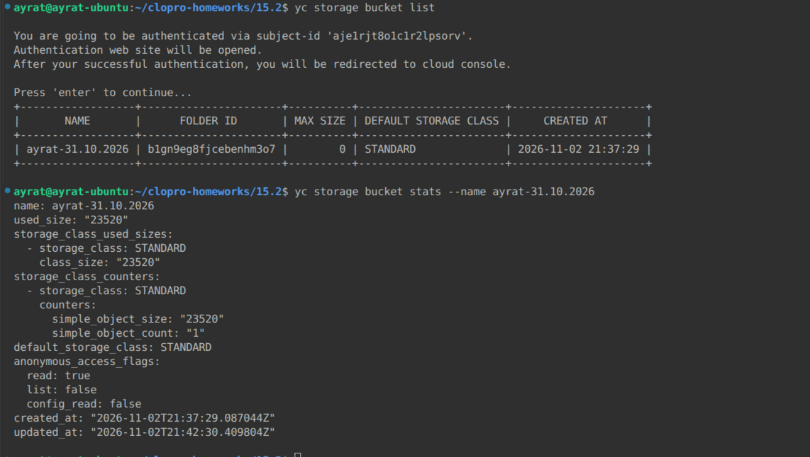
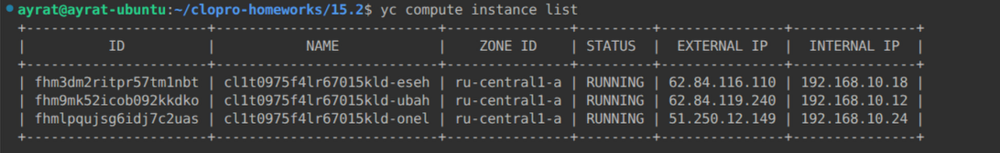
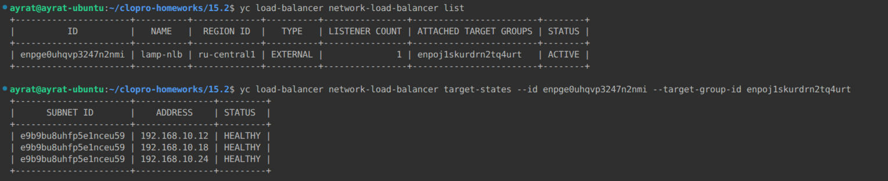
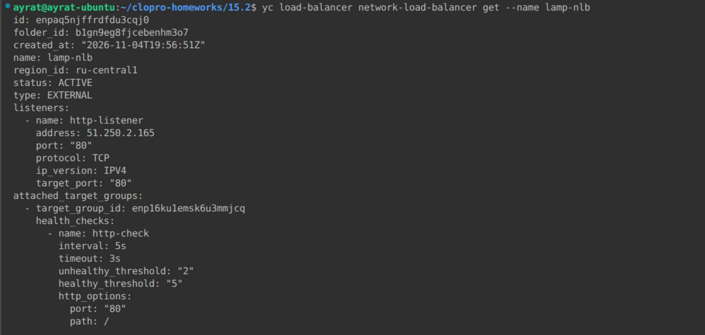
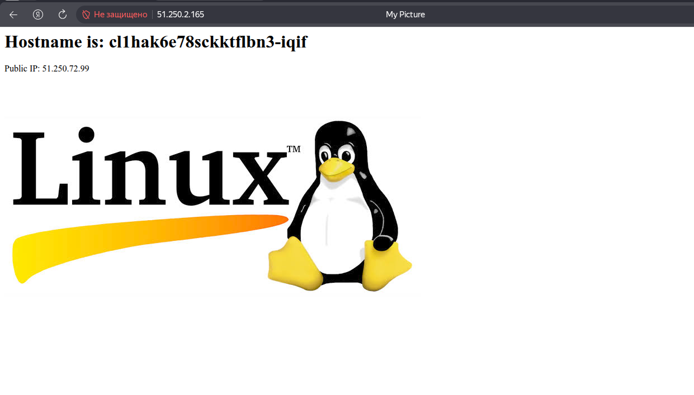
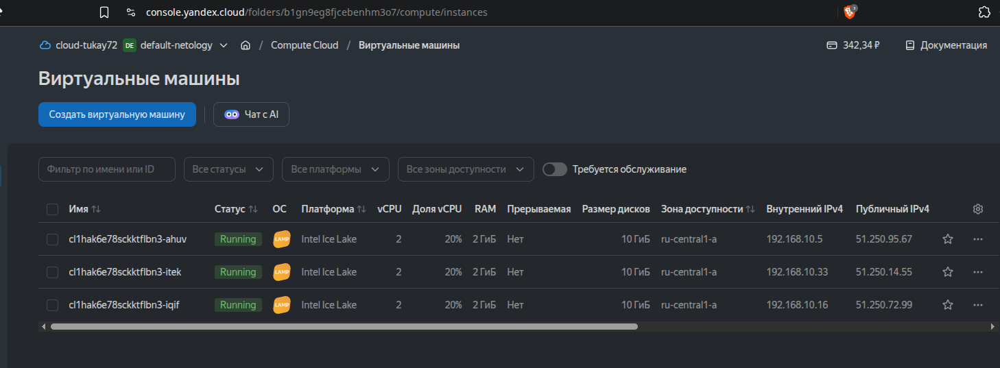
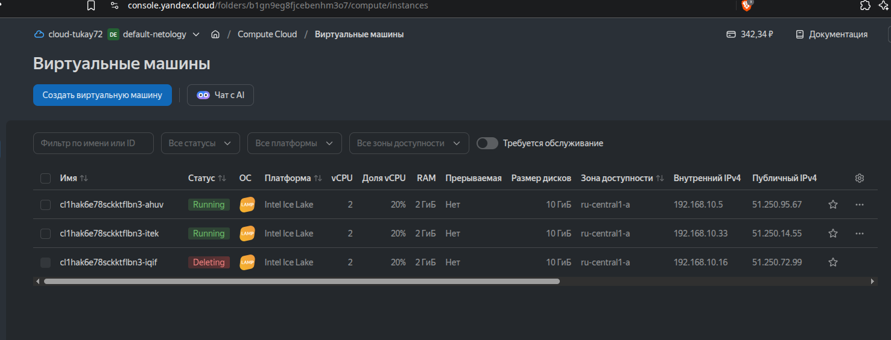
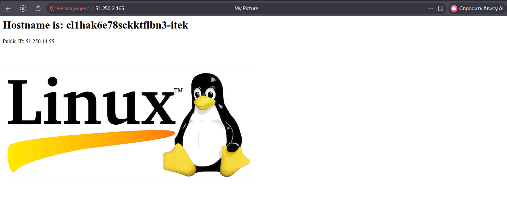
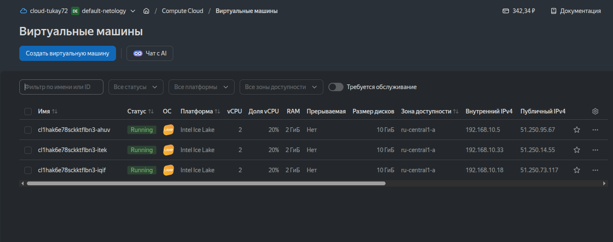

# Домашнее задание к занятию «Вычислительные мощности. Балансировщики нагрузки»  Тукаев Айрат

### Подготовка к выполнению задания

1. Домашнее задание состоит из обязательной части, которую нужно выполнить на провайдере Yandex Cloud, и дополнительной части в AWS (выполняется по желанию). 
2. Все домашние задания в блоке 15 связаны друг с другом и в конце представляют пример законченной инфраструктуры.  
3. Все задания нужно выполнить с помощью Terraform. Результатом выполненного домашнего задания будет код в репозитории. 
4. Перед началом работы настройте доступ к облачным ресурсам из Terraform, используя материалы прошлых лекций и домашних заданий.

---
## Задание 1. Yandex Cloud 

**Что нужно сделать**

1. Создать бакет Object Storage и разместить в нём файл с картинкой:

 - Создать бакет в Object Storage с произвольным именем (например, _имя_студента_дата_).
 - Положить в бакет файл с картинкой.
 - Сделать файл доступным из интернета.
 
2. Создать группу ВМ в public подсети фиксированного размера с шаблоном LAMP и веб-страницей, содержащей ссылку на картинку из бакета:

 - Создать Instance Group с тремя ВМ и шаблоном LAMP. Для LAMP рекомендуется использовать `image_id = fd827b91d99psvq5fjit`.
 - Для создания стартовой веб-страницы рекомендуется использовать раздел `user_data` в [meta_data](https://cloud.yandex.ru/docs/compute/concepts/vm-metadata).
 - Разместить в стартовой веб-странице шаблонной ВМ ссылку на картинку из бакета.
 - Настроить проверку состояния ВМ.
 
3. Подключить группу к сетевому балансировщику:

 - Создать сетевой балансировщик.
 - Проверить работоспособность, удалив одну или несколько ВМ.
4. (дополнительно)* Создать Application Load Balancer с использованием Instance group и проверкой состояния.

Полезные документы:

- [Compute instance group](https://registry.terraform.io/providers/yandex-cloud/yandex/latest/docs/resources/compute_instance_group).
- [Network Load Balancer](https://registry.terraform.io/providers/yandex-cloud/yandex/latest/docs/resources/lb_network_load_balancer).
- [Группа ВМ с сетевым балансировщиком](https://cloud.yandex.ru/docs/compute/operations/instance-groups/create-with-balancer).


**Выполнение:**  
1. Создал бакет Object Storage и разместил в нём файл с картинкой.  
```
variable "bucket_name" {
  type = string
}

variable "local_image_path" {
  type = string
}

# 1. Object Storage
resource "yandex_storage_bucket" "this" {
  bucket = var.bucket_name
  anonymous_access_flags {
    read = true
    list = false
  }
}

resource "yandex_storage_object" "image" {
  bucket = yandex_storage_bucket.this.id
  key    = "image.jpg"
  source = var.local_image_path
  content_type = "image/jpg"
}
```
Проверяю созданный бакет:  
    

2. Создал сеть, Security Groups и группу ВМ в public подсети фиксированного размера с шаблоном LAMP и веб-страницей, содержащей ссылку на картинку из бакета.  
```
variable "cloud_id" {
  type        = string
  description = "https://cloud.yandex.ru/docs/resource-manager/operations/cloud/get-id"
}
variable "folder_id" {
  type        = string
  description = "https://cloud.yandex.ru/docs/resource-manager/operations/folder/get-id"
}
variable "zone" {
  type        = string
  default     = "ru-central1-a"
  description = "https://cloud.yandex.ru/docs/overview/concepts/geo-scope"
}
variable "lamp_image_id" {
  type = string
  default = "fd827b91d99psvq5fjit"
}
variable "instance_group_size" {
  type = number
  default = 3
}
variable "public_cidr" {
  type        = list(string)
  default     = ["192.168.10.0/24"]
  description = "https://cloud.yandex.ru/docs/vpc/operations/subnet-create"
}
variable "vpc_name" {
  type        = string
  default     = "develop"
  description = "VPC network name"
}
variable "public_subnet_name" {
  type        = string
  default     = "public"
  description = "VPC subnet_public name"
}


# 2. Сеть
resource "yandex_vpc_network" "develop" {
  name = var.vpc_name
}

resource "yandex_vpc_subnet" "public" {
  name           = var.public_subnet_name
  zone           = var.zone
  network_id     = yandex_vpc_network.develop.id
  v4_cidr_blocks = var.public_cidr
}

# 3. Security Groups
resource "yandex_vpc_security_group" "vm-sg" {
  name        = "vm-sg"
  network_id  = yandex_vpc_network.develop.id
  
  ingress {
    protocol          = "TCP"
    port              = 80
    v4_cidr_blocks = ["0.0.0.0/0"]
  }

  ingress {
    protocol       = "TCP"
    port           = 22
    v4_cidr_blocks = ["0.0.0.0/0"] 
  }

   ingress {
    protocol          = "TCP"
    port              = 80
    v4_cidr_blocks    = ["198.18.235.0/24", "198.18.248.0/24"]
    description       = "Разрешение healthcheck балансировщика"
  }

  egress {
    protocol       = "ANY"
    v4_cidr_blocks = ["0.0.0.0/0"]
    port           = -1
  }
}

# 4. Instance Group
resource "yandex_compute_instance_group" "lamp_ig" {
  name               = "lamp-instance-group"
  service_account_id = data.yandex_iam_service_account.sa_ig.id
  
  instance_template {
    platform_id = "standard-v3"
    resources {
      cores         = 2
      memory        = 2
      core_fraction = 20
    }
    boot_disk {
      initialize_params {
        image_id = var.lamp_image_id
        size     = 10
        type     = "network-hdd"
      }
    }
    network_interface {
      subnet_ids         = [yandex_vpc_subnet.public.id]
      nat                = true
      security_group_ids = [yandex_vpc_security_group.vm-sg.id]
    }
    metadata = {
      user-data = templatefile("./cloud-init.yaml", {
        bucket_name = yandex_storage_bucket.this.id
      })
      private_ui_access-method = "os-login"
      enable-oslogin           = "true"
    }
  }

  scale_policy {
    fixed_scale {
      size = var.instance_group_size
    }
  }

  allocation_policy {
    zones = [var.zone]
  }

  deploy_policy {
    max_unavailable = 0
    max_expansion   = 1
  }

  load_balancer {
    target_group_name = "lamp-nlb-tg"
  }

  health_check {
    http_options {
      port = 80
      path = "/"
    }
    interval            = 30
    timeout             = 10
    healthy_threshold   = 2
    unhealthy_threshold = 3
  }
}

data "yandex_iam_service_account" "sa_ig" {
  name = "editor"
}
```
    


3. Подключил группу к сетевому балансировщику.  
```
# 5. Балансировщик
resource "yandex_lb_network_load_balancer" "nlb" {
  name               = "lamp-nlb"
  deletion_protection = "false"
  listener {
    name = "http-listener"
    port = 80
    target_port = 80
    external_address_spec {
      ip_version = "ipv4"
    }
  }
  attached_target_group {
    target_group_id = yandex_compute_instance_group.lamp_ig.load_balancer[0].target_group_id
    healthcheck {
      name = "http-check"
      interval = 2
      timeout = 1
      unhealthy_threshold = 2
      healthy_threshold = 5
      http_options {
        port = 80
        path = "/"
      }
    }
  }
}
```

    

Балансировщик и группы машин созданы, в работе.  

    

Проверяю доступность сайта. Сайт доступен.  

    

    

Проверяю работу балансировщика. Удалю машину на который идёт трафик.  

    

Балансировщик работает. Перевёл трафик на другую машину.  

    

Группа виртуальных машин тоже работает, создадась третья машина вместо удалённой.  

    


Ссылка на [main.tf](https://github.com/AyratTukay/clopro-homeworks/blob/main/15.2/main.tf)  
Ссылка на [variables.tf](https://github.com/AyratTukay/clopro-homeworks/blob/main/15.2/variables.tf)  
Ссылка на [providers.tf](https://github.com/AyratTukay/clopro-homeworks/blob/main/15.2/providers.tf)  
Ссылка на [outputs.tf](https://github.com/AyratTukay/clopro-homeworks/blob/main/15.2/outputs.tf)  


## Задание 2*. AWS (задание со звёздочкой)

Это необязательное задание. Его выполнение не влияет на получение зачёта по домашней работе.

**Что нужно сделать**

Используя конфигурации, выполненные в домашнем задании из предыдущего занятия, добавить к Production like сети Autoscaling group из трёх EC2-инстансов с  автоматической установкой веб-сервера в private домен.

1. Создать бакет S3 и разместить в нём файл с картинкой:

 - Создать бакет в S3 с произвольным именем (например, _имя_студента_дата_).
 - Положить в бакет файл с картинкой.
 - Сделать доступным из интернета.
2. Сделать Launch configurations с использованием bootstrap-скрипта с созданием веб-страницы, на которой будет ссылка на картинку в S3. 
3. Загрузить три ЕС2-инстанса и настроить LB с помощью Autoscaling Group.

Resource Terraform:

- [S3 bucket](https://registry.terraform.io/providers/hashicorp/aws/latest/docs/resources/s3_bucket)
- [Launch Template](https://registry.terraform.io/providers/hashicorp/aws/latest/docs/resources/launch_template).
- [Autoscaling group](https://registry.terraform.io/providers/hashicorp/aws/latest/docs/resources/autoscaling_group).
- [Launch configuration](https://registry.terraform.io/providers/hashicorp/aws/latest/docs/resources/launch_configuration).

Пример bootstrap-скрипта:

```
#!/bin/bash
yum install httpd -y
service httpd start
chkconfig httpd on
cd /var/www/html
echo "<html><h1>My cool web-server</h1></html>" > index.html
```
### Правила приёма работы

Домашняя работа оформляется в своём Git репозитории в файле README.md. Выполненное домашнее задание пришлите ссылкой на .md-файл в вашем репозитории.
Файл README.md должен содержать скриншоты вывода необходимых команд, а также скриншоты результатов.
Репозиторий должен содержать тексты манифестов или ссылки на них в файле README.md.
